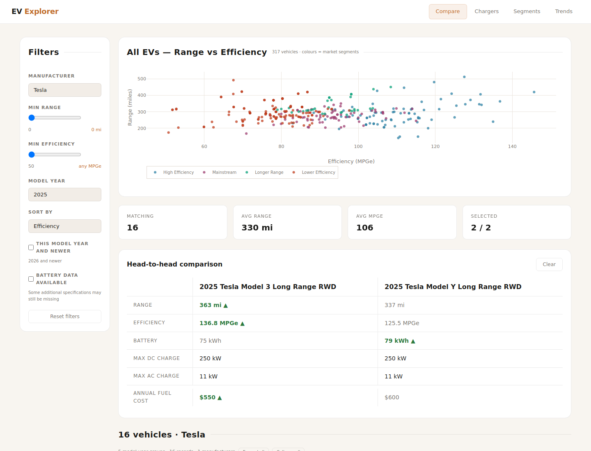

# EV Explorer

EV Explorer is a React and FastAPI application for comparing electric vehicles by range, efficiency, and operating cost and exploring US charging stations using EPA and AFDC data.

[Live demo](https://ev-explorer.up.railway.app) · [Source code](https://github.com/evantofu/EV-Explorer) · [CI checks](https://github.com/evantofu/EV-Explorer/actions)



## How to use

Open the [live demo](https://ev-explorer.up.railway.app), or follow the local installation steps below.

### 1. Browse electric vehicles

Open **Compare** and choose a manufacturer, model year, minimum range, or minimum efficiency. Expand a manufacturer to see model-year groups, then expand a group to inspect individual trims. The chart shows the broader market for the selected year.

### 2. Compare two vehicles

Select two vehicle records to see their range, efficiency, available battery and charging specifications, and EPA annual fuel costs side by side. Vehicle rows also show an electricity-cost estimate with stated driving and energy-price assumptions. Missing specifications remain blank.

### 3. Find charging stations

Open **Chargers** and search for a city or address, or use your location. Pan or zoom the map to load stations within the visible area. Filter by network, state, or DC fast charging. The interface shows at most 2,000 stations at once; zoom in to narrow the results.

### 4. Explore segments and trends

Open **Segments** to explore four descriptive efficiency/range groups. Open **Trends** to compare manufacturer efficiency over time. These views describe the dataset rather than predict vehicle performance or recommend a purchase.

## Prerequisites

- Python 3.12
- Node.js 22.12 or later
- Git

The application includes a data snapshot, so local setup does not require API keys. Map tiles and address search require internet access.

## Installation

### 1. Clone the repository

```bash
git clone https://github.com/evantofu/EV-Explorer.git
cd EV-Explorer
```

### 2. Install and start the backend

```bash
python3 -m venv .venv
source .venv/bin/activate
python -m pip install -r ev-app/backend/requirements.txt
python -m uvicorn main:app --app-dir ev-app/backend --reload --port 8000
```

On Windows, activate the environment with `.venv\Scripts\activate` instead. The API documentation is available at [localhost:8000/docs](http://localhost:8000/docs).

### 3. Install and start the frontend

Open a second terminal from the repository root:

```bash
cd ev-app/frontend
npm ci
npm run dev
```

Open [localhost:5173](http://localhost:5173). Vite forwards API requests to the backend on port 8000.

## Running with Docker

From the repository root:

```bash
docker compose up --build
```

Open [localhost:8000](http://localhost:8000). To stop the containers, run `docker compose down`. For the optional Vite development server, use `docker compose --profile dev up --build`.

## Data and expected output

The bundled **May 22, 2026** snapshot contains **1,274 consumer BEV model-year/trim records** after filtering and **80,203 charging-station locations**. Vehicle years span 2019–2027; these counts do not mean 1,274 distinct current models or real-time station availability.

| Data | Source |
|---|---|
| Fuel economy and range | [EPA vehicle export](https://www.fueleconomy.gov/feg/download.shtml) |
| Station locations | [AFDC API](https://developer.nlr.gov/docs/transportation/alt-fuel-stations-v1/) |
| Partial battery and charging specifications | [OpenEV](https://github.com/open-ev-data/open-ev-data-dataset) |

Model grouping uses a bundled lookup and deterministic fallback. Segments use quantile rules on latest-year base-model averages. Manufacturer trends require at least four years of data and an in-sample R² of 0.3; that fit statistic is not forecast accuracy. Inline cost estimates assume 13,500 miles/year and $0.16/kWh, with a gas comparison of $3.50/gallon at 25 mpg. Enrichment is heuristic, and some specifications are unavailable.

## Troubleshooting

- **Vehicle data does not load:** confirm the backend is running and open [localhost:8000/ready](http://localhost:8000/ready).
- **The map looks incomplete:** zoom in; the interface caps each response at 2,000 locations.
- **A specification is missing:** OpenEV enrichment covers only part of the dataset.
- **You replaced the snapshot files:** restart the backend to refresh its cached DataFrames.

## Development and testing

For the folder structure, data methods, refresh commands, configuration, and Python/frontend/browser test commands, see [Data and Development](docs/DATA_AND_DEVELOPMENT.md).

The stack includes Python, pandas, NumPy, FastAPI, React, Vite, Zustand, Plotly, Leaflet, Docker, and Railway.
